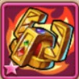
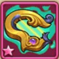

# Idle Heroes F2P Main Path Guide (0 to 6 Transcendence Heroes)

A streamlined, single-path progression guide for Free-to-Play (F2P) players from **Day 1 (0 Heroes)** to **6 Transcendence Heroes**. This guide eliminates conflicting routes and situational setups to focus strictly on the **Eloise → Lord of Fear Aspen (LFA)** hyper-carry path.

---

## Quick Reference: Heroes & Base Factions

| Order | Acronym | Transcendence Hero Name | Non-Transcendence Base Hero | Base Faction | First Used | Role |
| :--- | :--- | :--- | :--- | :--- | :--- | :--- |
| **1st** | — | — |  **Eloise** |  **Shadow** | Stage 0 | Early-Game Main Tank-Carry & 1st Homeowner (Swapped at 2nd Trans) |
| **2nd** | — | — |  **Ignis (9\*)** |  **Abyss** | Stage 0 | Suicide Control Immunity & Energy Feed Support |
| **3rd** | — | — |  **Waldeck (9\*)** |  **Abyss** | Stage 0 | Suicide Bleed & Attack Buff Support |
| **4th** | — | — |  **Tix** |  **Shadow** | Stage 0 | Early Burst Support & Eloise Slot 3 Tenant |
| **5th** | — | — |  **Carrie** |  **Dark** | Stage 0 | Energy Drain Support & Eloise Slot 4 Tenant |
| **6th** | — | — |  **Onkirimaru** |  **Shadow** | Stage 0 | Eloise Slot 1 Tenant → Permanent LFA Slot 3 Tenant |
| **7th** | — | — |  **Jahra** |  **Shadow** | Stage 1 | Eloise Slot 2 Tenant |
| **8th** |  **GSSW** |  Great Sage - Sun Wukong |  **Sun Wukong** |  **Light** | Stage 2 (1st Trans) | Temporary 1st Trans (Clears VC 1-1-10 for Grimoire; swapped at 2nd Trans) |
| **9th** |  **LFA** |  Lord of Fear - Aspen |  **Aspen** |  **Dark** | Stage 3 (1st/2nd Trans) | Main Carry & Permanent Homeowner (from 2nd Trans onward) |
| **10th** |  **SQH** |  Scarlet Queen - Halora |  **Queen** |  **Abyss** | Stage 3 (2nd Trans) | Primary Damage Buffer & LFA Slot 2 Tenant |
| **11th** | — | — |  **Drake** |  **Dark** | Stage 3 | Defense Down Debuffer & Permanent LFA Slot 1 Tenant |
| **12th** | — | — |  **Mockman** |  **Dark** | Stage 3 | Temporary LFA Slot 4 Tenant (Replaced by PDE at 3rd Trans) |
| **13th** |  **PDE** |  Phantom Defier - Elena |  **Elena** |  **Dark** | Stage 4 (3rd Trans) | Cleanser/Dodge Buffer & LFA Slot 4 Tenant |
| **14th** |  **TBB** |  Therapist of Blood - Betty |  **Betty** |  **Shadow** | Stage 5 (4th Trans) | Crowd Control (CC) Lockdown Specialist |
| **15th** |  **DGN** |  Doppelganger - Natalia |  **Natalie** |  **Light** | Stage 6 (5th Trans) | Shield & Damage Replication Buffer |
| **16th** |  **LBRM** |  Lady of Blossom Realm - Melissa |  **Melissa** |  **Forest** | Stage 7 (6th Trans) | Debuff Cleansing & Damage Amplification Support |

---

## Master Progression Timeline (0 to 6 Trans)

*Note: Crystal of Transcendence (CoT) income accelerates as you unlock Void Campaign, higher Realms Gate Corruption, and higher Void Vortex/Ark tiers (~4.5 months for 1st Trans → ~3 months for 2nd Trans → ~2–2.5 months per Trans thereafter).*

| Stage | Timeline | Milestone | Active Lineup (Positions 1 to 6) | Main Homeowner | Tenants (Slots 1 / 2 / 3 / 4) |
| :--- | :--- | :--- | :--- | :--- | :--- |
| **Stage 0** | Month 0–1 | First E5 Carry |  Eloise,  Ignis (9\*),  Waldeck (9\*),  Tix,  Carrie,  Onkirimaru | None | None |
| **Stage 1** | Month 1–2.5 | Pre-Trans Cloud Island |  Eloise,  Ignis (9\*),  Waldeck (9\*),  Tix,  Carrie,  Onkirimaru |  **Eloise** |  Onkirimaru /  Jahra /  Tix /  Carrie |
| **Stage 2** | Month 2.5–4.5 | **1st Trans Hero** (5M CoT) |  Eloise,  Ignis (9\*),  Waldeck (9\*),  **GSSW**,  Tix,  Carrie |  **Eloise** |  Onkirimaru /  Jahra /  Tix /  Carrie |
| **Stage 3** | Month 4.5–7.5 | **2nd Trans Pivot** (10M CoT) |  **LFA**,  Ignis (9\*),  **SQH**,  Drake,  Carrie,  Onkirimaru |  **LFA** |  Drake /  **SQH** /  Onkirimaru /  Mockman |
| **Stage 4** | Month 7.5–10 | **3rd Trans Hero** (15M CoT) |  **LFA**,  Ignis (9\*),  **SQH**,  **PDE**,  Drake,  Carrie |  **LFA** |  Drake /  **SQH** /  Onkirimaru /  **PDE** |
| **Stage 5** | Month 10–12.5 | **4th Trans Hero** (20M CoT) |  **LFA**,  **SQH**,  **PDE**,  **TBB**,  Carrie,  Drake |  **LFA** |  Drake /  **SQH** /  Onkirimaru /  **PDE** |
| **Stage 6** | Month 12.5–14.5 | **5th Trans Hero** (25M CoT) |  **LFA**,  **SQH**,  **PDE**,  **TBB**,  **DGN**,  Carrie |  **LFA** |  Drake /  **SQH** /  Onkirimaru /  **PDE** |
| **Stage 7** | Month 14.5–16.5 | **6th Trans Hero** (30M CoT) |  **LFA**,  **SQH**,  **PDE**,  **TBB**,  **DGN**,  **LBRM** |  **LFA** |  Drake /  **SQH** /  Onkirimaru /  **PDE** |

> **Golden Resource Rule:** Always choose **Stellar Shards** over **Crystals of Transcendence (CoT)** from every chest and event. Never convert Spheres of Transcendence into CoT—always convert Spheres into **Stellar Shards**.

---

## Master Artifact Build Order

Build Mysterious (P2W) Artifacts to **Splendid (3\*, 4 copies merged)** in this exact stage-aligned order:

1. **Stage 1** —  **1× Base Golden Crown** (1 copy only) — Equipped on  **Eloise** (Stages 1–2).
2. **Stage 1–2** —  **1× Splendid Melodic Strings** (4 copies) — Equipped on  **Tix** (Stage 1) →  **GSSW** (Stage 2) →  **LFA** (Stages 3–7).
3. **Stage 3** —  **1st Splendid Demon Bell** (4 copies) — Equipped on  **SQH** (Stages 3–7) for Round 1 energy feed.
4. **Stage 4** —  **2nd Splendid Demon Bell** (4 copies) — Equipped on  **PDE** (Stages 4–7) for Round 1 energy feed.
5. **Stage 5** —  **1× Splendid Illusive Mirror** (4 copies) — Equipped on  **TBB** (Stages 5–7) for instant 100 starting energy + AoE Twine CC.
6. **Stage 6** —  **3rd Splendid Demon Bell** (4 copies) — Equipped on  **DGN** (Stages 6–7) for Round 1 energy feed.
7. **Stage 7** —  **4th Splendid Demon Bell** (4 copies) — Equipped on  **LBRM** (Stage 7) for Round 1 energy feed.

---

## Stage-by-Stage Build Guide

### Stage 0: Early Game Foundation (Month 0–1)
Focus 100% of food and copies on building **Eloise to E5** first. Do not build multiple heroes simultaneously. Keep **Ignis** and **Waldeck** at **9\* Level 100** with no gear so they die in Round 1 and buff Eloise.

| Lineup Pos | Hero (Faction) | Role | Enables | Void Level | Void Imprints | Tree Level | Essence (Sublimation) | Core Level | Stone | Artifact |
| :--- | :--- | :--- | :--- | :--- | :--- | :--- | :--- | :--- | :--- | :--- |
| **Pos 1** |  **Eloise** ( Shadow) | **Main Tank-Carry** | `1-1-4-1-2` | V0 (E5) | — | T0 | `0/0/0/0` | `0*` | **HP / Attack** |  **Base Golden Crown** |
| **Pos 2** |  **Ignis (9\*)** ( Abyss) | Suicide CC Immunity / Energy | — | — (9\*) | — | — | — | — | None (Naked) | None (Naked) |
| **Pos 3** |  **Waldeck (9\*)** ( Abyss) | Suicide Attack / Bleed Buff | — | — (9\*) | — | — | — | — | None (Naked) | None (Naked) |
| **Pos 4** |  **Tix** ( Shadow) | Burst Support (Aspen / Tower) | `2-2-4-2-2` | V0 (E5) | — | T0 | `0/0/0/0` | `0*` | **Attack / Attack** | Any +Attack Artifact |
| **Pos 5** |  **Carrie** ( Dark) | Energy Drain Support | `2-2-4-2-2` | V0 (E5) | — | T0 | `0/0/0/0` | `0*` | **Attack / Attack** | Any +Attack Artifact |
| **Pos 6** |  **Onkirimaru** ( Shadow) | Lineup Fill / Future Tenant | `2-2-4-2-2` | V0 (E5) | — | T0 | `0/0/0/0` | `0*` | **Attack / Attack** | Any +Attack Artifact |

---

### Stage 1: Pre-Transcendence Cloud Island (Month 1–2.5)
Once Eloise reaches **Void Imprint 4 (V4)**, she unlocks **Cloud Island** as your first Homeowner. Build her 4 Tenants to E5.

| Lineup Pos | Hero (Faction) | Role | Enables | Void Level | Void Imprints | Tree Level | Essence (Sublimation) | Core Level | Stone | Artifact |
| :--- | :--- | :--- | :--- | :--- | :--- | :--- | :--- | :--- | :--- | :--- |
| **Pos 1** |  **Eloise** ( Shadow) | **Main Homeowner / Tank-Carry** | `1-1-4-1-2` | **V4** | — | **T3 (Lvl 60)** | `0/0/0/0` (Spiritual Essence only) | `0*` | **HP / Attack** |  **Base Golden Crown** |
| **Pos 2** |  **Ignis (9\*)** ( Abyss) | Suicide CC Immunity / Energy | — | — (9\*) | — | — | — | — | None (Naked) | None (Naked) |
| **Pos 3** |  **Waldeck (9\*)** ( Abyss) | Suicide Attack / Bleed Buff | — | — (9\*) | — | — | — | — | None (Naked) | None (Naked) |
| **Pos 4** |  **Tix** ( Shadow) | Eloise Tenant (Slot 3) / Burst | `2-2-4-2-2` | V0 (E5) | — | T0 | `0/0/0/0` | `0*` | **Attack / Attack** |  **Splendid Melodic Strings** |
| **Pos 5** |  **Carrie** ( Dark) | Eloise Tenant (Slot 4) / Energy Drain | `2-2-4-2-2` | V0 (E5) | — | T0 | `0/0/0/0` | `0*` | **Attack / Attack** | Any +Attack Artifact |
| **Pos 6** |  **Onkirimaru** ( Shadow) | Eloise Tenant (Slot 1) | `2-2-4-2-2` | V0 (E5) | — | T0 | `0/0/0/0` | `0*` | **Attack / Attack** | Any +Attack Artifact |
| — |  **Jahra** ( Shadow) | Eloise Tenant (Slot 2) | `2-2-4-2-2` | V0 (E5) | — | T0 | `0/0/0/0` | `0*` | **Attack / Attack** | Any +Attack Artifact |

---

### Stage 2: 1st Transcendence Hero — GSSW (Month 2.5–4.5)
At **5M Crystals of Transcendence**, transcend **Sun Wukong (Light)** into **Great Sage - Sun Wukong (GSSW)**. **Keep Eloise as your main Homeowner**—do not move Eloise out of her house yet. Invest Stellar Shards to **V4 + T2 (Lvl 40) GSSW** (rather than V4ing Eloise's non-Trans tenants) so GSSW can clear **Void Campaign 1-1-10** immediately and unlock passive **Primal Grimoire** resource drops.

| Lineup Pos | Hero (Base / Faction) | Role | Enables | Void Level | Void Imprints | Tree Level | Essence (Sublimation) | Core Level | Stone | Artifact |
| :--- | :--- | :--- | :--- | :--- | :--- | :--- | :--- | :--- | :--- | :--- |
| **Pos 1** |  **Eloise** ( Shadow) | **Main Homeowner / Tank-Carry** | `1-1-4-1-2` | **V4** | — | **T3 (Lvl 60)** | `0/0/0/0` | `0*` | **HP / Attack** |  **Base Golden Crown** |
| **Pos 2** |  **Ignis (9\*)** ( Abyss) | Suicide CC Immunity / Energy | — | — (9\*) | — | — | — | — | None (Naked) | None (Naked) |
| **Pos 3** |  **Waldeck (9\*)** ( Abyss) | Suicide Attack / Bleed Buff | — | — (9\*) | — | — | — | — | None (Naked) | None (Naked) |
| **Pos 4** |  **GSSW** ( Sun Wukong -  Light) | 1st Trans / CC & Shielder | `2-2-4-2-2` | **V4** | **Crit Dmg / Holy Dmg / Precision** | **T2 (Lvl 40)** | `0/0/0/0` | `0*` | **Crit / Crit Dmg / Atk** |  **Splendid Melodic Strings** |
| **Pos 5** |  **Tix** ( Shadow) | Eloise Tenant (Slot 3) / Burst | `2-2-4-2-2` | V0 (E5) | — | T0 | `0/0/0/0` | `0*` | **Attack / Attack** | Any +Attack Artifact |
| **Pos 6** |  **Carrie** ( Dark) | Eloise Tenant (Slot 4) / Energy Drain | `2-2-4-2-2` | V0 (E5) | — | T0 | `0/0/0/0` | `0*` | **Attack / Attack** | Any +Attack Artifact |
| — |  **Onkirimaru** ( Shadow) | Eloise Tenant (Slot 1) | `2-2-4-2-2` | V0 (E5) | — | T0 | `0/0/0/0` | `0*` | **Attack / Attack** | Any +Attack Artifact |
| — |  **Jahra** ( Shadow) | Eloise Tenant (Slot 2) | `2-2-4-2-2` | V0 (E5) | — | T0 | `0/0/0/0` | `0*` | **Attack / Attack** | Any +Attack Artifact |

---

### Stage 3: 2nd Transcendence Pivot — LFA + SQH (Month 4.5–7.5)
At **10M Crystals of Transcendence** (and ~18M+ Stellar Shards), perform the **Main Pivot**:
1. Regress **Eloise (Shadow)** and **GSSW (Sun Wukong - Light)** (complete the *Glory Challenge* Tree of Origin level 120 quests across  Abyss,  Shadow,  Fortress, and  Forest during this regression to claim massive free Stellar Shards and Spiritual Essence).
2. Transcend **Aspen (Dark)** into **Lord of Fear - Aspen (LFA)** and **Queen (Abyss)** into **Scarlet Queen - Halora (SQH)**.
3. Make **LFA** your permanent **Main Homeowner** in Cloud Island.

* **Speed Order:** **`SQH` > `LFA`** — SQH must act before LFA in Round 1 so her Demon Bell feeds energy and her Active buffs Crit Damage + applies Abyssal Corruption before LFA strikes (remove LFA's boots if LFA's house makes him too fast).

| Lineup Pos | Hero (Base / Faction) | Role | Enables | Void Level | Void Imprints | Tree Level | Essence (Sublimation) | Core Level | Stone | Artifact |
| :--- | :--- | :--- | :--- | :--- | :--- | :--- | :--- | :--- | :--- | :--- |
| **Pos 1** |  **LFA** ( Aspen -  Dark) | **Main Homeowner / Carry** | `2-2-4-2-2` | **V4** | **Crit Dmg / Holy Dmg / Precision** | **T5 (Lvl 100)** | **`4/0/0/4`** (Max Active, then Max P3) | **`0*`** | **Crit / Crit Dmg / Atk** |  **Splendid Melodic Strings** |
| **Pos 2** |  **Ignis (9\*)** ( Abyss) | Suicide CC Immunity / Energy | — | — (9\*) | — | — | — | — | None (Naked) | None (Naked) |
| **Pos 3** |  **SQH** ( Queen -  Abyss) | LFA Tenant (Slot 2) / Buffer | `3-1-4-3-2` | **V4** | **Dmg Red / Armor / Block** | **T3 (Lvl 60)** | **`4/0/0/0`** (Max Active) | `0*` | **Speed / Attack** |  **Splendid Demon Bell** |
| **Pos 4** |  **Drake** ( Dark) | LFA Tenant (Slot 1) / Debuffer | `2-2-4-2-2` | V0 (E5) | — | T0 | `0/0/0/0` | `0*` | **Attack / Attack** | Any +Attack Artifact |
| **Pos 5** |  **Carrie** ( Dark) | Energy Drain Support | `2-2-4-2-2` | V0 (E5) | — | T0 | `0/0/0/0` | `0*` | **Attack / Attack** | Any +Attack Artifact |
| **Pos 6** |  **Onkirimaru** ( Shadow) | LFA Tenant (Slot 3) | `2-2-4-2-2` | V0 (E5) | — | T0 | `0/0/0/0` | `0*` | **Attack / Attack** | Any +Attack Artifact |
| — |  **Mockman** ( Dark) | LFA Tenant (Slot 4 Temp) | `2-2-4-2-2` | V0 (E5) | — | T0 | `0/0/0/0` | `0*` | **Attack / Attack** | Any +Attack Artifact |

---

### Stage 4: 3rd Transcendence Hero — PDE (Month 7.5–10)
At **15M Crystals of Transcendence**, transcend **Elena (Dark)** into **Phantom Defier - Elena (PDE)**. She replaces Mockman in **Slot 4 of LFA's House**, completing LFA's double-Transcendence tenant core and supercharging LFA's Attack stat.

* **Speed Order:** **`SQH`, `PDE` > `LFA`** — Both Speed-stone Demon Bell supports act before LFA in Round 1 to feed energy and buff LFA before he attacks.

| Lineup Pos | Hero (Base / Faction) | Role | Enables | Void Level | Void Imprints | Tree Level | Essence (Sublimation) | Core Level | Stone | Artifact |
| :--- | :--- | :--- | :--- | :--- | :--- | :--- | :--- | :--- | :--- | :--- |
| **Pos 1** |  **LFA** ( Aspen -  Dark) | **Main Homeowner / Carry** | `2-2-4-2-2` | **V4** | **Crit Dmg / Holy Dmg / Precision** | **T5 (Lvl 120)** | **`4/0/4/4`** (Add Max P2) | **`1*`** | **Crit / Crit Dmg / Atk** |  **Splendid Melodic Strings** |
| **Pos 2** |  **Ignis (9\*)** ( Abyss) | Suicide CC Immunity / Energy | — | — (9\*) | — | — | — | — | None (Naked) | None (Naked) |
| **Pos 3** |  **SQH** ( Queen -  Abyss) | LFA Tenant (Slot 2) / Buffer | `3-1-4-3-2` | **V4** | **Dmg Red / Armor / Block** | **T5 (Lvl 100)** | **`4/0/0/4`** (Max Active & P3) | `0*` | **Speed / Attack** |  **Splendid Demon Bell** |
| **Pos 4** |  **PDE** ( Elena -  Dark) | LFA Tenant (Slot 4) / Cleanser | `3-1-4-3-2` | **V4** | **Dmg Red / Armor / Block** | **T5 (Lvl 100)** | **`1/0/4/0`** (1 node Active, Max P2) | `0*` | **Speed / Attack** |  **Splendid Demon Bell** |
| **Pos 5** |  **Drake** ( Dark) | LFA Tenant (Slot 1) / Debuffer | `2-2-4-2-2` | V0 (E5) | — | T0 | `0/0/0/0` | `0*` | **Attack / Attack** | Any +Attack Artifact |
| **Pos 6** |  **Carrie** ( Dark) | Energy Drain Support | `2-2-4-2-2` | V0 (E5) | — | T0 | `0/0/0/0` | `0*` | **Attack / Attack** | Any +Attack Artifact |
| — |  **Onkirimaru** ( Shadow) | LFA Tenant (Slot 3) | `2-2-4-2-2` | V0 (E5) | — | T0 | `0/0/0/0` | `0*` | **Attack / Attack** | Any +Attack Artifact |

---

### Stage 5: 4th Transcendence Hero — TBB (Month 10–12.5)
At **20M Crystals of Transcendence**, transcend **Betty (Shadow)** into **Therapist of Blood - Betty (TBB)**. TBB is the ultimate Crowd Control hero in Void Campaign.
* **Critical Mechanic:** TBB requires her **1\* Core of Origin** active in battle to instantly trigger AoE Twine whenever she gains full energy. She only needs **Tree Level 20 (T1)** to equip her 1\* Core—do not over-invest Stellar Shards into her over LFA's tenants.

* **Speed Order:** **`SQH`, `PDE` > `LFA`** (TBB's speed does not matter because her `1* Core` + `Illusive Mirror` starts her at 100 Energy and triggers AoE Twine passively after the first action of Round 1).

| Lineup Pos | Hero (Base / Faction) | Role | Enables | Void Level | Void Imprints | Tree Level | Essence (Sublimation) | Core Level | Stone | Artifact |
| :--- | :--- | :--- | :--- | :--- | :--- | :--- | :--- | :--- | :--- | :--- |
| **Pos 1** |  **LFA** ( Aspen -  Dark) | **Main Homeowner / Carry** | `2-2-4-2-2` | **V4** | **Crit Dmg / Holy Dmg / Precision** | **T5 (Lvl 120)** | **`4/4/4/4` (Full Sublimation)** | **`3*` (Noble / DT)** | **Crit / Crit Dmg / Atk** |  **Splendid Melodic Strings** |
| **Pos 2** |  **SQH** ( Queen -  Abyss) | LFA Tenant (Slot 2) / Buffer | `3-1-4-3-2` | **V4** | **Dmg Red / Armor / Block** | **T5 (Lvl 100)** | **`4/0/0/4`** | `0*` | **Speed / Attack** |  **Splendid Demon Bell** |
| **Pos 3** |  **PDE** ( Elena -  Dark) | LFA Tenant (Slot 4) / Cleanser | `3-1-4-3-2` | **V4** | **Dmg Red / Armor / Block** | **T5 (Lvl 100)** | **`1/0/4/4`** (Add Max P3) | `0*` | **Speed / Attack** |  **Splendid Demon Bell** |
| **Pos 4** |  **TBB** ( Betty -  Shadow) | Crowd Control Lockdown | `1-1-4-1-2` | **V4** | **Dmg Red / Armor / Block** | **T1 (Lvl 20)** | **`0/0/0/0`** | **`1*` (Active Core)** | **HP / HP** |  **Splendid Illusive Mirror** |
| **Pos 5** |  **Carrie** ( Dark) | Energy Drain Support | `2-2-4-2-2` | V0 (E5) | — | T0 | `0/0/0/0` | `0*` | **Attack / Attack** | Any +Attack Artifact |
| **Pos 6** |  **Drake** ( Dark) | LFA Tenant (Slot 1) / Debuffer | `2-2-4-2-2` | V0 (E5) | — | T0 | `0/0/0/0` | `0*` | **Attack / Attack** | Any +Attack Artifact |
| — |  **Onkirimaru** ( Shadow) | LFA Tenant (Slot 3) | `2-2-4-2-2` | V0 (E5) | — | T0 | `0/0/0/0` | `0*` | **Attack / Attack** | Any +Attack Artifact |

> **Core of Origin Priority:** Get **1\* TBB Core** (2× 50-shard chests / 100 shards) immediately when building TBB and activate it in every Void Campaign wave. Put all other Core chests into **LFA's 3\* Noble Core (8× 50-shard chests / 400 shards)** so LFA can unlock **Destiny Transition (DT)**.

---

### Stage 6: 5th Transcendence Hero — DGN (Month 12.5–14.5)
At **25M Crystals of Transcendence**, transcend **Natalie (Light)** into **Doppelganger - Natalia (DGN)**. DGN replicates buffs/shields and dramatically increases LFA's survivability and burst ceiling in Void Campaign Chapters 4–5+.

* **Speed Order:** **`SQH`, `PDE`, `DGN` > `LFA`** — All three Speed-stone Demon Bell supports act before LFA in Round 1 to stack buffs and feed energy before LFA's Active.

| Lineup Pos | Hero (Base / Faction) | Role | Enables | Void Level | Void Imprints | Tree Level | Essence (Sublimation) | Core Level | Stone | Artifact |
| :--- | :--- | :--- | :--- | :--- | :--- | :--- | :--- | :--- | :--- | :--- |
| **Pos 1** |  **LFA** ( Aspen -  Dark) | **Main Homeowner (DT)** | `2-2-4-2-2` | **V4** | **Crit Dmg / Holy Dmg / Precision** | **T5 (Lvl 120)** | **`4/4/4/4`** | **`3*` (Destiny Transition)** | **Crit / Crit Dmg / Atk** |  **Splendid Melodic Strings** |
| **Pos 2** |  **SQH** ( Queen -  Abyss) | LFA Tenant (Slot 2) (DT) | `3-1-4-3-2` | **V4** | **Dmg Red / Armor / Block** | **T5 (Lvl 120)** | **`4/4/4/4` (Full for DT)** | **`3*` (2nd DT Target)** | **Speed / Attack** |  **Splendid Demon Bell** |
| **Pos 3** |  **PDE** ( Elena -  Dark) | LFA Tenant (Slot 4) | `3-1-4-3-2` | **V4** | **Dmg Red / Armor / Block** | **T5 (Lvl 100)** | **`1/0/4/4`** | `0*` | **Speed / Attack** |  **Splendid Demon Bell** |
| **Pos 4** |  **TBB** ( Betty -  Shadow) | Crowd Control Lockdown | `1-1-4-1-2` | **V4** | **Dmg Red / Armor / Block** | **T1 (Lvl 20)** | **`0/0/0/0`** | **`1*` (Active in VC)** | **HP / HP** |  **Splendid Illusive Mirror** |
| **Pos 5** |  **DGN** ( Natalie -  Light) | Buffer / Shield Replicator | `3-1-4-3-2` | **V4** | **Dmg Red / Armor / Block** | **T5 (Lvl 100)** | **`1/0/0/4`** (1 Active, Max P3) | `0*` | **Speed / HP** |  **Splendid Demon Bell** |
| **Pos 6** |  **Carrie** ( Dark) | Energy Drain Support | `2-2-4-2-2` | V0 (E5) | — | T0 | `0/0/0/0` | `0*` | **Attack / Attack** | Any +Attack Artifact |
| — |  **Drake** ( Dark) | LFA Tenant (Slot 1) | `2-2-4-2-2` | V0 (E5) | — | T0 | `0/0/0/0` | `0*` | **Attack / Attack** | Any +Attack Artifact |
| — |  **Onkirimaru** ( Shadow) | LFA Tenant (Slot 3) | `2-2-4-2-2` | V0 (E5) | — | T0 | `0/0/0/0` | `0*` | **Attack / Attack** | Any +Attack Artifact |

---

### Stage 7: 6th Transcendence Hero — LBRM (Month 14.5–16.5)
At **30M Crystals of Transcendence**, transcend **Melissa (Forest)** into **Lady of Blossom Realm - Melissa (LBRM)** to complete your full 6-Transcendence lineup (`LFA + SQH + PDE + TBB + DGN + LBRM`). LBRM cleanses debilitating control/attribute reduction effects and amplifies LFA's damage.

* **Speed Order:** **`SQH`, `PDE`, `DGN`, `LBRM` > `LFA`** — All four Speed-stone Demon Bell supports act before LFA in Round 1 to cleanse, buff, and overcharge LFA's energy before he strikes.

| Lineup Pos | Hero (Base / Faction) | Role | Enables | Void Level | Void Imprints | Tree Level | Essence (Sublimation) | Core Level | Stone | Artifact |
| :--- | :--- | :--- | :--- | :--- | :--- | :--- | :--- | :--- | :--- | :--- |
| **Pos 1** |  **LFA** ( Aspen -  Dark) | **Main Homeowner (DT)** | `2-2-4-2-2` | **V4** | **Crit Dmg / Holy Dmg / Precision** | **T5 (Lvl 120)** | **`4/4/4/4`** | **`3*` (DT)** | **Crit / Crit Dmg / Atk** |  **Splendid Melodic Strings** |
| **Pos 2** |  **SQH** ( Queen -  Abyss) | LFA Tenant (Slot 2) (DT) | `3-1-4-3-2` | **V4** | **Dmg Red / Armor / Block** | **T5 (Lvl 120)** | **`4/4/4/4`** | **`3*` (DT)** | **Speed / Attack** |  **Splendid Demon Bell** |
| **Pos 3** |  **PDE** ( Elena -  Dark) | LFA Tenant (Slot 4) (DT) | `3-1-4-3-2` | **V4** | **Dmg Red / Armor / Block** | **T5 (Lvl 120)** | **`4/4/4/4` (Full for DT)** | **`3*` (3rd DT Target)** | **Speed / Attack** |  **Splendid Demon Bell** |
| **Pos 4** |  **TBB** ( Betty -  Shadow) | Crowd Control Lockdown | `1-1-4-1-2` | **V4** | **Dmg Red / Armor / Block** | **T1 (Lvl 20)** | **`0/0/0/0`** | **`1*`** | **HP / HP** |  **Splendid Illusive Mirror** |
| **Pos 5** |  **DGN** ( Natalie -  Light) | Buffer / Shield Support | `3-1-4-3-2` | **V4** | **Dmg Red / Armor / Block** | **T5 (Lvl 100)** | **`1/0/4/4`** | `0*` | **Speed / HP** |  **Splendid Demon Bell** |
| **Pos 6** |  **LBRM** ( Melissa -  Forest) | Cleanser / Damage Amp | `3-1-4-3-2` | **V4** | **Dmg Red / Armor / Block** | **T5 (Lvl 100)** | **`4/0/0/4`** (Max Active & P3) | `0*` | **Speed / HP** |  **Splendid Demon Bell** |
| — |  **Drake** ( Dark) | LFA Tenant (Slot 1) | `2-2-4-2-2` | V0 (E5) | — | T0 | `0/0/0/0` | `0*` | **Attack / Attack** | Any +Attack Artifact |
| — |  **Onkirimaru** ( Shadow) | LFA Tenant (Slot 3) | `2-2-4-2-2` | V0 (E5) | — | T0 | `0/0/0/0` | `0*` | **Attack / Attack** | Any +Attack Artifact |

---

## Summary Priority Checklists

### 1. Sublimation Essence Order (`Active / P1 / P2 / P3`)
Each node costs **45,000 Sublimation Essence** (`4` nodes = **180,000** for a full branch; **720,000** for `4/4/4/4` required for Destiny Transition):
1.  **LFA Active:** `4/0/0/0` (180k)
2.  **LFA Passive 3:** `4/0/0/4` (180k)
3.  **SQH Active:** `4/0/0/0` (180k)
4.  **LFA Passive 2:** `4/0/4/4` (180k)
5.  **PDE Active (1 node) + Passive 2:** `1/0/4/0` (225k)
6.  **SQH Passive 3:** `4/0/0/4` (180k)
7.  **PDE Passive 3:** `1/0/4/4` (180k)
8.  **LFA Passive 1:** `4/4/4/4` (180k — completes LFA for 1st Destiny Transition)
9.  **SQH Passive 2 + Passive 1:** `4/4/4/4` (360k — completes SQH for 2nd Destiny Transition)
10.  **DGN Active (1 node) + Passive 3:** `1/0/0/4` (225k)
11.  **PDE Remaining Active (3 nodes) + Passive 1:** `4/4/4/4` (315k — completes PDE for 3rd Destiny Transition)
12.  **LBRM Active + Passive 3:** `4/0/0/4` (360k)

### 2. Core of Origin & Destiny Transition (DT) Order
Unlocking **Destiny Transition (DT)** on a hero requires **Tree Level 120 (T5)**, **Full Sublimation (`4/4/4/4`)**, and a **3\* Noble Core**. Each **1\* Primary Core** requires **100 Core Shards** (2× 50-shard chests); a **3\* Noble Core** requires **400 Core Shards** (8× 50-shard chests):
1.  **TBB 1\* Core** (100 shards / 2 chests) — Mandatory for her passive AoE Twine CC in Void Campaign. Stop at 1\*.
2.  **LFA 3\* Noble Core** (400 shards / 8 chests) — Unlocks **1st Destiny Transition (LFA)**.
3.  **SQH 3\* Noble Core** (400 shards / 8 chests) — Unlocks **2nd Destiny Transition (SQH)**.
4.  **PDE 3\* Noble Core** (400 shards / 8 chests) — Unlocks **3rd Destiny Transition (PDE)**.

### 3. Enables Reference (`E1`–`E5`)
All heroes use **`4` (CC Purify)** in `E3` and **`2` (Unbending Will)** in `E5`:
* **`2-2-4-2-2` (Carry & Pure Tenants — `LFA`, `GSSW`, `Onkirimaru`, `Jahra`, `Tix`, `Carrie`, `Drake`, `Mockman`):** `+8% Atk` / `+12% Extra Dmg` / `CC Purify` / `+8% Atk` / `Unbending Will`
* **`3-1-4-3-2` (Speed Supports — `SQH`, `PDE`, `DGN`, `LBRM`):** `+6% HP, +4% Atk, +20 Spd` / `-15% Crit Dmg Received` / `CC Purify` / `+6% HP, +4% Atk, +20 Spd` / `Unbending Will`
* **`1-1-4-1-2` (Tank-Carry & CC — `Eloise`, `TBB`):** `+12% HP` / `-15% Crit Dmg Received` / `CC Purify` / `+12% HP` / `Unbending Will`

| Tier | `1` | `2` | `3` | `4` | `5` | `6` |
| :--- | :--- | :--- | :--- | :--- | :--- | :--- |
| **E1** | `+12% HP` | `+8% Atk` | `+6% HP, +4% Atk, +20 Spd` | — | — | — |
| **E2** | `-15% Crit Dmg Received` | `+12% Extra Dmg` | `+15% Healed Effect` | — | — | — |
| **E3** | Heal Self (`15%` missing HP) | Self Atk (`+1.2%` per hero) | Mark Purify | **CC Purify** | DoT Purify | Attr Reduction Purify |
| **E4** | `+12% HP` | `+8% Atk` | `+6% HP, +4% Atk, +20 Spd` | — | — | — |
| **E5** | Self HP on Crit or `+30%` Dmg | **Fatal Damage Shield** | — | — | — | — |
